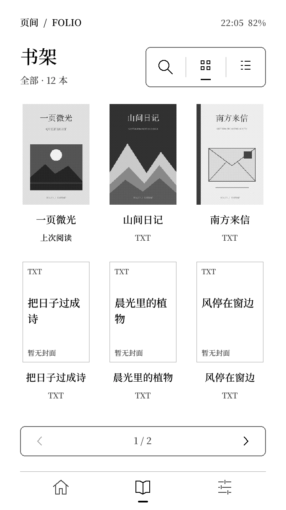

# 页间 Folio

小纸 Pico（RDP-G01-W）的第三方阅读固件。

支持 TXT / EPUB 本地阅读、手机传书、微信读书、排版调整、阅读统计和在线更新。本地书籍不联网也能读。

[官网与一键安装](<https://qmqsu.github.io/folio/>) · [下载固件](<https://github.com/qmqsu/folio/releases>) · [安装与适配说明](<docs/刷机说明.md>) · [问题反馈](<https://github.com/qmqsu/folio/issues>)

<p align="center">
  
  
  
</p>

## 能做什么

- **本地阅读**：TXT / EPUB、目录、书签、封面、续读和阅读统计。
- **书架管理**：搜索、排序和封面显示。
- **手机传书**：通过浏览器批量上传书籍、图片和字体。
- **阅读排版**：字体、字号、行距、页边距和对齐方式可调。
- **微信读书（实验）**：登录、查看书架、下载后离线阅读和手动同步。
- **个性化与更新**：时间锁屏、自定义关机壁纸、设备内更新和 TF 卡升级。

## 安装

仅支持小纸 Pico（RDP-G01-W）。安装前请阅读[适配、备份与恢复说明](<docs/刷机说明.md>)，并备份重要书籍、阅读记录及需要保留的设备数据。

1. 在电脑上用 Chrome 或 Edge 打开[官网](<https://qmqsu.github.io/folio/>)。
2. 用 USB 数据线连接小纸 Pico。
3. 点击“一键刷入”，按向导核对设备并完成安装。

网页安装会校验发布签名、镜像、芯片和分区布局，不强制下载 16 MiB 全 Flash 备份，也不会主动擦除 TF 卡。Safari、Firefox 和多数手机浏览器不支持网页刷机通路。

首次安装后，可以在设备上手动检查稳定版更新，不必每次重新刷机。网络不方便时，也可以使用 TF 卡升级。

## 书籍、图片和字体

在 TF 卡根目录放置 `books`、`fonts`、`picture`，分别保存书籍、自备字体和图片。隐藏的 `.folio` 保存阅读进度、书签、缓存和统计，不要为了清理更新文件而删除整个目录。

应用自带宋体，另有黑体、楷体和圆体独立资源。资源不可用时回退宋体，不会清除记住的字体选择。字体来源、格式限制和许可见[许可清单](<LICENSES.md>)及[刷机说明](<docs/刷机说明.md>)。

手工 TF 更新使用 `update/folio.bin` 和 `update/folio.bin.sha256`。只使用来源可信并自行核验的镜像，详细步骤见[刷机说明](<docs/刷机说明.md>)。

## 当前限制

- 不支持其他板型、未知 Flash 型号或未核对的分区布局。
- EPUB 主要支持文字、目录和封面，暂不支持正文图片布局、CSS、固定排版和 DRM。
- TF 卡书架最多显示 128 本书，支持 FAT32。
- 微信读书使用非公开协议，可能随上游变化失效；只处理当前账号有权访问的内容，不是腾讯官方客户端。

完整适配范围、备份和恢复方法见[构建、安装与恢复](<docs/刷机说明.md>)。

## 从源码构建

使用 ESP-IDF v6.1 / ESP32-S3 工具链。发行 CI 固定 SDK 提交和工具清单，不依赖浮动 `latest`。

```sh
. "$IDF_PATH/export.sh"
sh tools/idf.sh build
```

[构建脚本](<tools/idf.sh>)默认把输出放在系统临时目录，避免含中文的工程路径触发工具链问题；也可设置 `FOLIO_BUILD_DIR`。发布配置显式关闭 USB 调试，不公开本地 `sdkconfig`。

主机测试覆盖解析、签名、设置、电源和 UI 渲染等逻辑，但不能替代真实网络、USB、TF、断电回滚、温升和墨水屏物理显示验收。网站开发与安装器说明见[site/README](<site/README.md>)。

## 文档

- [构建、安装与恢复](<docs/刷机说明.md>)：适配硬件、网页安装、TF 更新、字体资源和恢复方法。
- [发布与在线更新](<docs/发布与在线更新.md>)：签名清单、稳定版通道和更新规则。
- [网站与安装器](<site/README.md>)：官网构建、测试和刷机实现。
- [发行维护指南](<.github/RELEASING.md>)：发布、验收和源码包维护。
- [许可清单](<LICENSES.md>)：自研与第三方代码、字体及资源的许可范围。

## 许可

自研代码采用 [MIT](<LICENSE>)。EPDiy、官方板级组件、协议参考、字体及其他第三方代码分别保留原许可；根目录 MIT 不重新许可它们。发行材料包含对应源码、许可、构建信息及 LGPL 重链接材料。
